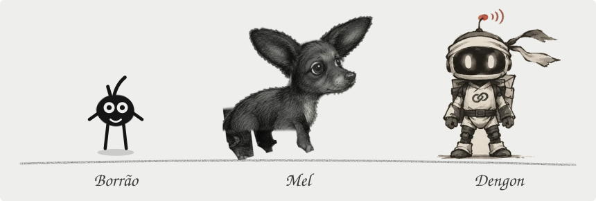
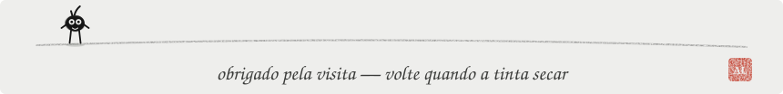

<picture><source media="(prefers-color-scheme: dark)" srcset="assets/enso-dark.svg"></picture>

<em>Olá! Sou o André, dev front-end que pinta interfaces com código. Tinta, papel e um pouquinho de bagunça.</em>

<picture><source media="(prefers-color-scheme: dark)" srcset="assets/personagens-dark.svg"></picture>

<a href="https://github.com/andreluaan/Portifolio"><picture><source media="(prefers-color-scheme: dark)" srcset="assets/card-portifolio-dark.svg"></picture></a>
<a href="https://github.com/andreluaan/Sumi-System"><picture><source media="(prefers-color-scheme: dark)" srcset="assets/card-sumi-system-dark.svg"></picture></a>

<a href="https://github.com/andreluaan/Jokenpo-da-saideira"><picture><source media="(prefers-color-scheme: dark)" srcset="assets/card-jokenpo-dark.svg"></picture></a>
<a href="https://github.com/andreluaan/MovieTrack"><picture><source media="(prefers-color-scheme: dark)" srcset="assets/card-movietrack-dark.svg"></picture></a>

<picture><source media="(prefers-color-scheme: dark)" srcset="assets/rodape-dark.svg"></picture>

